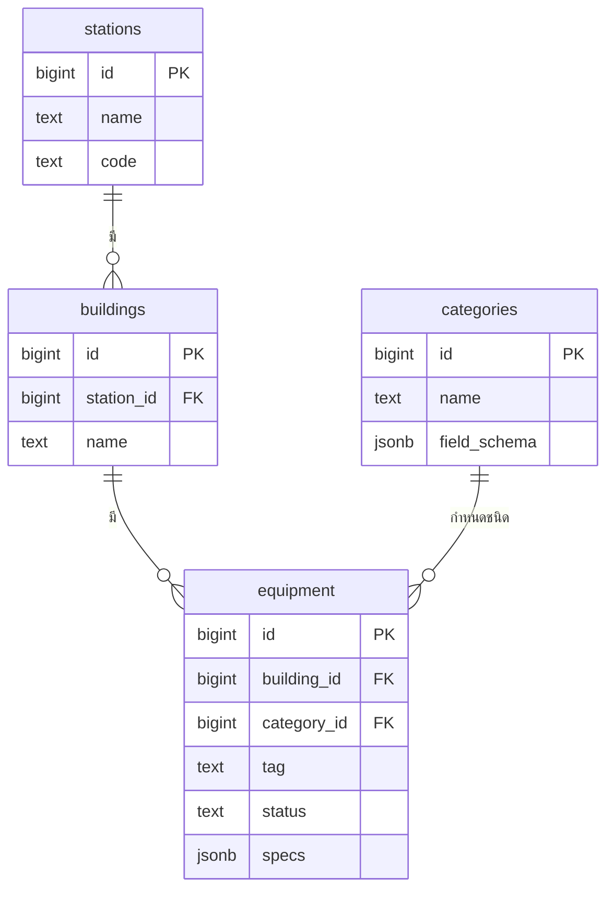

<div align="center">

# ⚙️ ทะเบียนอุปกรณ์สถานี

**ระบบเก็บและค้นหาข้อมูลอุปกรณ์ในสถานีผลิตน้ำ**
กปภ.สาขาบ้านบึง


</div>

---

## ✨ ความสามารถ

| | |
|---|---|
| 🏭 **ลำดับข้อมูล** | สถานี → อาคาร → หมวดอุปกรณ์ → อุปกรณ์ |
| 🔄 **มอเตอร์ / ชุดสูบน้ำ** | Nameplate มอเตอร์, ข้อมูลปั๊ม, การควบคุม, ประวัติบำรุงรักษา (55 ช่อง) |
| 🧩 **เพิ่มหมวดได้เอง** | สร้างหมวดใหม่และกำหนดช่องข้อมูลผ่านหน้าเว็บ ไม่ต้องแก้โค้ด |
| 🔍 **ค้นหา** | รหัส, ชื่อ, ยี่ห้อ, Serial No. |
| 🔐 **ระบบแอดมิน** | ล็อกอิน, ลืมรหัสผ่าน, เปลี่ยนรหัสผ่าน, สิทธิ์แก้ไขเฉพาะแอดมิน (RLS) |
| 📷 **รูปภาพ** | Nameplate, รหัสเครื่อง, รูปอุปกรณ์ (ย่อขนาดอัตโนมัติ) |
| 🔧 **ประวัติซ่อมบำรุง** | บันทึก PM/ซ่อม/ตรวจวัด พร้อมกราฟแนวโน้ม IR, กระแส, Vibration |
| 🏷️ **QR Code** | สแกนเปิดหน้าอุปกรณ์ + พิมพ์สติกเกอร์ทีละหลายป้าย |
| 📊 **Export** | Excel (แยกชีตตามหมวด) และ PDF สำหรับพิมพ์ |
| 📈 **Dashboard** | สรุปจำนวนตามสถานะ, kW / kVA ต่อสถานี, เครื่องที่ต้องติดตาม |
| 👥 **สิทธิ์รายสถานี** | แอดมิน / ผู้ดูแลสถานี (แก้ได้เฉพาะสถานีที่ได้รับมอบหมาย) / ผู้ใช้ |
| 📜 **ประวัติการแก้ไข** | บันทึกอัตโนมัติ ใคร แก้อะไร เมื่อไร (ค่าเดิม → ค่าใหม่) |
| 💾 **Backup** | ดาวน์โหลด/กู้คืนข้อมูลทั้งหมดเป็น JSON |
| ⏰ **Keep-alive** | Cloudflare Cron ปลุก Supabase ทุกวัน กันโปรเจกต์ถูกหยุด |
| 🖨️ **พิมพ์** | หน้ารายละเอียดอุปกรณ์จัดหน้าสำหรับพิมพ์ |

---

## 🚀 เริ่มต้นใช้งาน

### 1. ตั้งค่า Supabase

1. สร้างโปรเจกต์ที่ [supabase.com](https://supabase.com)
2. **SQL Editor** → รันทีละไฟล์ตามลำดับ: [`schema.sql`](supabase/schema.sql) → [`photos.sql`](supabase/photos.sql) → [`v2.sql`](supabase/v2.sql) → [`v3.sql`](supabase/v3.sql)
3. **Authentication → Users → Add user** (ติ๊ก *Auto Confirm User*)
4. ตั้งเป็นแอดมิน:
   ```sql
   update public.profiles set role = 'admin' where email = 'you@example.com';
   ```
5. **Authentication → URL Configuration** → เพิ่ม Redirect URLs
   ```
   http://localhost:5173/**
   https://<your-site>.pages.dev/**
   ```

> [!TIP]
> ปิดการสมัครสมาชิกเอง: **Authentication → Providers → Email** → ปิด *Allow new users to sign up*

### 2. รันบนเครื่อง

สร้างไฟล์ `.env` (ดูตัวอย่างจาก `.env.example`)

```env
VITE_SUPABASE_URL=https://xxxxxxxx.supabase.co
VITE_SUPABASE_ANON_KEY=sb_publishable_xxxxxxxx
```

```bash
npm install
npm run dev
```

เปิด http://localhost:5173

> [!WARNING]
> ใช้เฉพาะ **Publishable / anon key** เท่านั้น ห้ามใช้ `service_role` หรือ secret key และห้าม commit ไฟล์ `.env`

### 3. Deploy (Cloudflare Pages)

**Workers & Pages → Create → Pages → Connect to Git**

| ตั้งค่า | ค่า |
|---|---|
| Framework preset | React (Vite) |
| Build command | `npm run build` |
| Output directory | `dist` |
| Environment variables | `VITE_SUPABASE_URL`, `VITE_SUPABASE_ANON_KEY` |

หลังจากนั้น `git push` ทุกครั้งเว็บจะอัปเดตอัตโนมัติ

---

## 🗄️ โครงสร้างฐานข้อมูล



| ตาราง | หน้าที่ |
|---|---|
| `stations` | สถานี |
| `buildings` | อาคาร (อยู่ใต้สถานี) |
| `categories` | หมวดอุปกรณ์ + `field_schema` แม่แบบช่องข้อมูล |
| `equipment` | อุปกรณ์ เก็บค่าตามแม่แบบใน `specs` (jsonb) |
| `profiles` | สิทธิ์ผู้ใช้ `viewer` / `admin` |

---

## 📁 โครงสร้างโปรเจกต์

```
equipment-web/
├── supabase/schema.sql      # ตาราง, RLS, หมวดเริ่มต้น
├── src/
│   ├── pages/               # หน้าดูข้อมูล + login / reset password
│   │   └── admin/           # หน้าจัดการข้อมูล
│   ├── components/
│   ├── lib/fields.js        # helper สำหรับ field_schema
│   └── supabase.js          # Supabase client
└── .env                     # (ไม่ commit)
```

---

## 💡 เคล็ดลับ

- **ชุดสูบน้ำสเปกเดียวกัน** — เปิดแก้ไขชุดแรก → *คัดลอกเป็นรายการใหม่* → แก้แค่รหัส / Serial
- **เพิ่มอุปกรณ์ชนิดใหม่** — จัดการข้อมูล → หมวดอุปกรณ์ → *+ เพิ่มหมวด* แล้วติ๊ก *แสดงในตาราง* ให้ช่องสำคัญ
- **ให้เฉพาะคนล็อกอินดูได้** — แก้ `using (true)` เป็น `using (auth.uid() is not null)` ใน `schema.sql`
